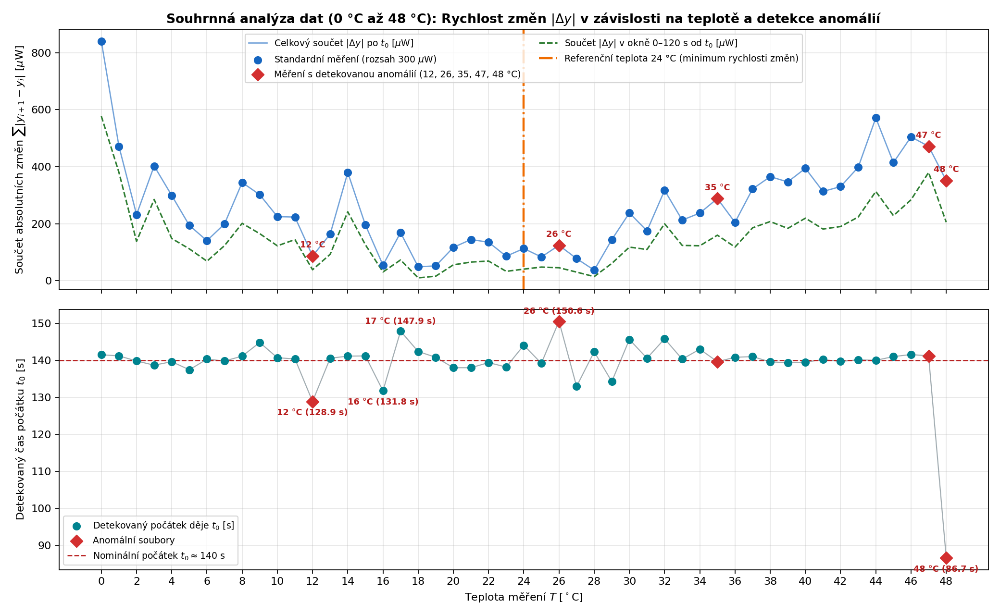
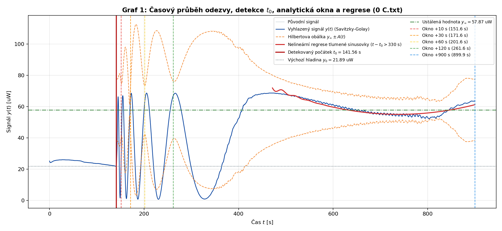
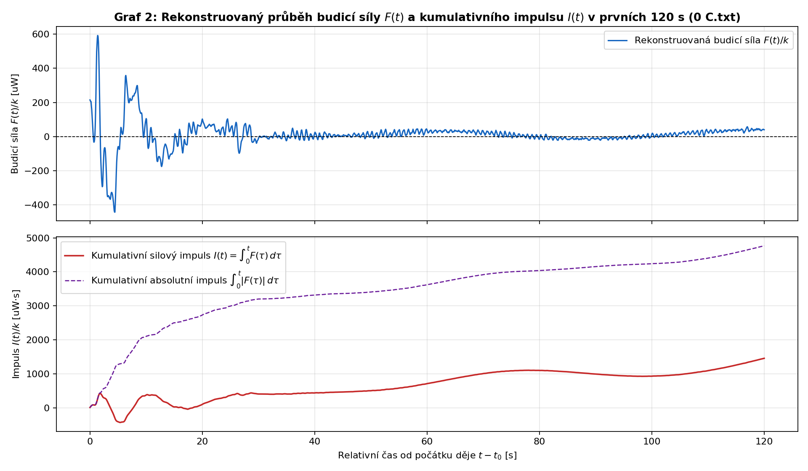
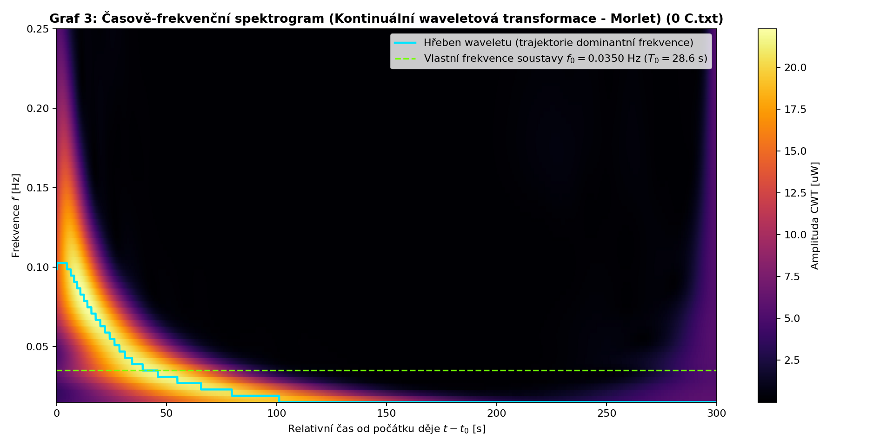
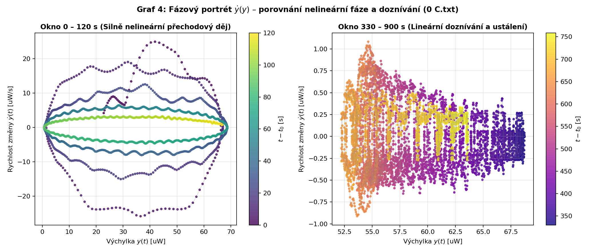

# Analýza měřených dat a dokumentace programu (`signal_analyzer.py`)

Tato zpráva shrnuje výsledky hloubkové kontroly všech 49 datových souborů (`0 C.txt` až `48 C.txt`) podle zadání v [README_DATA.MD](README_DATA.MD) a specifikace v [README_PROGRAM.MD](README_PROGRAM.MD).

---

## 1. Skutečný formát datových souborů a fyzikální podstata měření

> [!IMPORTANT]
> **Nesoulad se zadáním v `README_PROGRAM.MD`:** Soubory v adresáři `data/` **nejsou** prosté dvou-sloupcové CSV/TSV soubory bez hlavičky. Jde o logovací soubory optického měřicího systému **Ophir StarLab Version 3.20 Build 9** s fotodiodovým senzorem **Vega Photodiode PD300-IR** (s/n: 842699, vlnová délka $\lambda = 1559\text{ nm}$).

* **Struktura hlavičky (řádky 1–31):**
  * Řádky `1` až `30` obsahují metadata uvozená znaky `;` nebo `!` (datum a čas záznamu `;Logged:`, měřicí rozsah `;Settings:Range:`, předpočtené statistiky `;Min:`, `;Max:`, `;Average:`, `;Std.Dev.:`, `;Overrange:`).
  * Řádek `31` tvoří tabulátorem oddělená hlavička sloupců `Timestamp` a `Channel A`.
  * Samotná data začínají až na **řádku 32** ($13\,503$ nebo $13\,504$ řádků záznamu v délce $900\text{ s}$).
* **Fyzikální interpretace signálu:**
  * Sloupec `Channel A` udává optický výkon ve **Wattech $[\text{W}]$** (ve vědecké notaci `2.530e-005`, tj. $25{,}30\ \mu\text{W}$).
  * Fyzikálně jde o výstup **optického interferometru**, kde měřený výkon $I(t) = I_{\min} + (I_{\max} - I_{\min})\sin^2(\phi(t))$ odpovídá fázovému posuvu $\phi(t)$ vyvolanému teplotní dilatací / mechanickou deformací soustavy. Při standardním rozsahu `300uW` prochází signál interferometrickými proužky mezi $\approx 1{,}0\ \mu\text{W}$ a $\approx 56\text{--}68\ \mu\text{W}$.

---

## 2. Kontrola skutečného vzorkování (16 Hz vs. 15 Hz vs. 20 Hz)

Detailní statistická kontrola všech $661\,632$ vzorkovacích kroků $\Delta t = t_{i+1} - t_i$ napříč všemi 49 soubory ukázala:

| Interval $\Delta t$ $[\text{s}]$ | Okamžitá frekvence $1/\Delta t$ $[\text{Hz}]$ | Počet výskytů | Podíl v datech | Vysvětlení |
| :--- | :--- | :--- | :--- | :--- |
| **$0{,}064\text{ s}$** | **$15{,}625\text{ Hz}$ ($\approx 16\text{ Hz}$)** | $503\,205$ | **$76{,}06\text{ \%}$** | Základní perioda interního časovače ($64\text{ ms}$) |
| **$0{,}063\text{ s}$ / $0{,}065\text{ s}$** | $15{,}87\text{ Hz}$ / $15{,}38\text{ Hz}$ | $103\,561$ | **$15{,}65\text{ \%}$** | Zaokrouhlení časové značky $\pm 1\text{ ms}$ |
| **$0{,}095\text{--}0{,}097\text{ s}$** | $10{,}31\text{--}10{,}53\text{ Hz}$ | $54\,840$ | **$8{,}29\text{ \%}$** | **Pravidelná komunikační prodleva každého 12. vzorku** ($+32\text{ ms}$) |

> [!NOTE]
> * **Základní takt senzoru** je přesně $\Delta t = 64\text{ ms}$, což odpovídá **$15{,}625\text{ Hz}$ (nominálně uváděných $16\text{ Hz}$)**.
> * Přesně **každý 12. vzorek** ($8{,}33\text{ \%}$ kroků, tj. jednou za $\approx 0{,}80\text{ s}$) však nastává komunikační prodleva USB/StarLab bufferu o délce $\Delta t = 0{,}096\text{ s}$ ($96\text{ ms}$).
> * Kvůli těmto periodickým prodlevám činí **efektivní průměrná vzorkovací frekvence** přesně **$15{,}0033\text{ Hz}$** ($13\,504\text{ vzorků} / 900\text{ s}$, průměrný krok $\overline{\Delta t} = 0{,}06665\text{ s}$).
> * **Doporučená hodnota pro převzorkování (`resample_fs`):** V programu [signal_analyzer.py](signal_analyzer.py) je jako výchozí nastavena hodnota **$f_s = 16{,}0\text{ Hz}$** ($\Delta t = 0{,}0625\text{ s}$), která přesně odpovídá základnímu hardwarovému kroku senzoru bez umělého převzorkování nahoru; přes parametr `--fs 20.0` lze volitelně přepnout i na $20\text{ Hz}$ z `README_PROGRAM.MD`.

---

## 3. Odhalené chyby a anomálie v datových souborech

Automatická forenzní kontrola (kontrolní součty MD5, metadata hlaviček, detekce výpadků a detekce počátku děje $t_0$) odhalila v datové sadě **5 závažných anomálií**:

| Soubor | Typ chyby / anomálie | Detailní popis zjištění | Doporučené řešení v programu |
| :--- | :--- | :--- | :--- |
| **[47 C.txt](data/47%20C.txt)** | **Chybně označené měření (100% duplicita)** | Soubor má **identický MD5 hash (`c5a044c2`)**, stejné datum záznamu (`13/12/2024 at 10:20:12`) i všech $13\,503$ datových řádků jako soubor **[1 C.txt](data/1%20C.txt)**. Při ukládání měření pro $1\ ^\circ\text{C}$ došlo k jeho duplicitnímu uložení pod názvem `47 C.txt`. | Automatická detekce duplicit pomocí MD5 v dávkovém zpracování a označení v reportu. |
| **[48 C.txt](data/48%20C.txt)** | **Předčasný počátek děje ($t_0 = 86{,}69\text{ s}$) + jiný rozsah (`30.0uW`)** | Měření pochází ze starší kampaně (**23. 9. 2024**, zatímco ostatní jsou z prosince 2024 / ledna 2025). Přístroj byl přepnut na rozsah **`30.0uW`** (10× jemnější krok $10\text{ nW}$, strop proužku $\approx 31{,}5\ \mu\text{W}$ místo $\approx 68\ \mu\text{W}$) a děj začal již v **$t_0 = 86{,}69\text{ s}$** místo $\approx 140\text{ s}$. | Automatická detekce $t_0$ v širokém okně $[55, 220]\text{ s}$ a normalizace amplitudy počtem průchodů proužkem (`fringe_sweeps`). |
| **[12 C.txt](data/12%20C.txt)** | **Odlišný rozsah (`30.0uW`) + dřívější počátek ($t_0 = 128{,}94\text{ s}$)** | Rovněž měřeno **23. 9. 2024** s rozsahem **`30.0uW`** (maximum $31{,}9\ \mu\text{W}$). Kvůli poloviční amplitudě proužku by prostý součet $|\Delta y|$ ve Wattech vypadal 2× menší než u sousedních teplot $11\ ^\circ\text{C}$ a $13\ ^\circ\text{C}$. Počátek děje nastává již v **$t_0 = 128{,}94\text{ s}$**. | Normalizace na dynamický rozsah proužku (`fringe_sweeps`) eliminuje skok způsobený přepnutím rozsahu. |
| **[35 C.txt](data/35%20C.txt)** | **Hardwarový výpadek signálu (dropout na $0\text{ W}$)** | V čase **$t = 795{,}420\text{ s}$ až $798{,}012\text{ s}$** (řádky 11966–12005, trvání $2{,}59\text{ s}$, 40 vzorků) vypadl signál fotodiody z $30{,}8\ \mu\text{W}$ skokově na **$0{,}000\text{ W}$** a poté se vrátil na $26{,}5\ \mu\text{W}$. Bez ošetření tento umělý skok $\pm 30\ \mu\text{W}$ zkreslí derivace i regresi v okně 900 s. | Automatický deglitching (detekce párových skoků $>10\ \mu\text{W}$ na nulu a lineární interpolace přes výpadek). |
| **[26 C.txt](data/26%20C.txt)** (a další posunuté $t_0$) | **Opožděný nebo dřívější počátek děje $t_0$** | Doba začátku děje kolísá mezi **$86{,}7\text{ s}$ a $150{,}6\text{ s}$** (např. `26 C.txt`: $t_0 = 150{,}63\text{ s}$; `17 C.txt`: $t_0 = 147{,}94\text{ s}$; `32 C.txt`: $t_0 = 145{,}88\text{ s}$; `30 C.txt`: $t_0 = 145{,}69\text{ s}$; `16 C.txt`: $t_0 = 131{,}81\text{ s}$; `27 C.txt`: $t_0 = 133{,}00\text{ s}$; `29 C.txt`: $t_0 = 134{,}31\text{ s}$). | Dvoufázová fázově linearizovaná detekce $t_0$ s lomenou regresí (broken-stick hinge model). |

---

## 4. Ověření fyzikální hypotézy z `README_DATA.MD` (závislost na $|T - 24\ ^\circ\text{C}|$)

Podle [README_DATA.MD](README_DATA.MD) se sleduje rychlost změny $|y_{i+1} - y_i|$ a platí: *„čím je větší rozdíl od teploty $24\ ^\circ\text{C}$, tím jsou změny rychlejší“*.

* **Potvrzení závislosti:** Korelace mezi teplotním rozdílem $|T - 24\ ^\circ\text{C}|$ a celkovou absolutní změnou po $t_0$ dosahuje **$r = 0{,}7455$** (a po normalizaci na šířku interferometrického proužku `fringe_sweeps_120s`, která koriguje rozsah `30.0uW` u souborů `12 C.txt` a `48 C.txt`, dokonce **$r = 0{,}7754$**).
* **Tři fyzikální režimy podle vzdálenosti od $24\ ^\circ\text{C}$:**
  1. **Blízko pokojové teploty ($18\ ^\circ\text{C}$ až $28\ ^\circ\text{C}$, $|T - 24| \le 6\ ^\circ\text{C}$):** Teplotní gradient je malý, fáze interferometru neprojde ani jedním celým proužkem nebo jen jedním obratem ($\sum |\Delta y| \approx 37\text{--}144\ \mu\text{W}$). Děj má charakter pomalé, silně tlumené relaxace.
  2. **Střední rozdíl teplot ($6\text{--}17\ ^\circ\text{C}$ a $29\text{--}37\ ^\circ\text{C}$, $|T - 24| \in [7, 18]\ ^\circ\text{C}$):** Rozvinuté cyklické tlumené kmitání s $2{,}5\text{--}6$ průchody interferometrickým proužkem ($\sum |\Delta y| \approx 170\text{--}380\ \mu\text{W}$) a postupným prodlužováním periody.
  3. **Velký rozdíl teplot ($0\text{--}5\ ^\circ\text{C}$ a $38\text{--}48\ ^\circ\text{C}$, $|T - 24| \ge 19\ ^\circ\text{C}$):** Rychlý počáteční náběh ($\dot{y}_{\max}$ až $25{,}8\ \mu\text{W/s}$ u `0 C.txt`) a $6\text{--}12{,}4$ průchodů proužkem ($\sum |\Delta y|$ až $839{,}9\ \mu\text{W}$ u `0 C.txt` a $571{,}2\ \mu\text{W}$ u `44 C.txt`).



---

## 5. Diagnostické grafy a výsledky analýzy podle `README_PROGRAM.MD`

Program [signal_analyzer.py](signal_analyzer.py) odděluje výpočetní třídu `SignalAnalyzer` od vizualizační třídy `SignalPlotter` a ukládá strukturovaný JSON výstup [output/analysis_report.json](output/analysis_report.json) i souhrnný katalog všech 49 měření [output/batch_summary.csv](output/batch_summary.csv) a [output/batch_summary.json](output/batch_summary.json).

### Graf 1: Celý průběh signálu $y(t)$, detekce $t_0$, 5 časových oken, obálka a regrese


### Graf 2: Rekonstruovaný časový průběh budicí síly $F(t)$ a kumulativního impulsu $I(t)$


### Graf 3: Časově-frekvenční spektrogram (CWT – Morletův wavelet)


### Graf 4: Fázový portrét $\dot{y}(y)$ pro okno 0–120 s vs. 330–900 s


---

## 6. Doporučené hodnoty konfiguračních parametrů (`SystemConfig`)

| Parametr | Doporučená hodnota | Zdůvodnění |
| :--- | :--- | :--- |
| `resample_fs` | **`16.0` Hz** ($\Delta t = 0{,}0625\text{ s}$) | Odpovídá skutečnému hardwarovému taktu senzoru ($64\text{ ms} \equiv 15{,}625\text{ Hz}$). Volitelně lze zadat `--fs 20.0`. |
| `savgol_window_sec` | **`1.0` s** ($17$ vzorků při $16\text{ Hz}$) | Optimální kompromis: potlačuje kvantizační šum ($0{,}1\ \mu\text{W}$), ale nezkresluje nejrychlejší první kmit ($T_1 \approx 8{,}4\text{--}9{,}8\text{ s}$). |
| `savgol_polyorder` | **`3`** | Kubický polynom umožňuje hladký analytický výpočet první ($\dot{y}$) i druhé ($\ddot{y}$) derivace. |
| `cwt_freqs` | **`0.015` až `0.25` Hz** | Pokrývá celý rozsah kmitání od nejrychlejšího náběhu ($T \approx 4\text{--}9\text{ s}$) po pomalé nelineární periody ($T \approx 32\text{--}66\text{ s}$). |

---

## 7. Přehled detekovaných počátků $t_0$ a rychlostí změn pro všech 49 souborů

| Soubor | Teplota $[{}^\circ\text{C}]$ | $\|T - 24\|$ $[{}^\circ\text{C}]$ | Rozsah | Detekované $t_0$ $[\text{s}]$ | $\sum \|\Delta y\|$ (0–120 s) $[\mu\text{W}]$ | $\sum \|\Delta y\|$ (po $t_0$) $[\mu\text{W}]$ | Průchody proužkem (120 s) | Stav / Anomálie |
| :--- | :---: | :---: | :---: | :---: | :---: | :---: | :---: | :--- |
| `0 C.txt` | 0 | 24 | `300uW` | 141.56 | 577.40 | 839.90 | 8.49 | OK |
| `1 C.txt` | 1 | 23 | `300uW` | 141.25 | 379.60 | 471.60 | 6.82 | OK |
| `2 C.txt` | 2 | 22 | `300uW` | 139.88 | 139.70 | 232.00 | 2.14 | OK |
| `3 C.txt` | 3 | 21 | `300uW` | 138.75 | 285.30 | 402.50 | 5.09 | OK |
| `4 C.txt` | 4 | 20 | `300uW` | 139.69 | 148.20 | 299.10 | 2.68 | OK |
| `5 C.txt` | 5 | 19 | `300uW` | 137.50 | 112.00 | 194.20 | 2.05 | OK |
| `6 C.txt` | 6 | 18 | `300uW` | 140.38 | 68.60 | 140.60 | 1.27 | OK |
| `7 C.txt` | 7 | 17 | `300uW` | 139.88 | 123.30 | 199.70 | 2.23 | OK |
| `8 C.txt` | 8 | 16 | `300uW` | 141.19 | 201.40 | 344.60 | 3.04 | OK |
| `9 C.txt` | 9 | 15 | `300uW` | 144.88 | 165.10 | 301.80 | 3.03 | OK |
| `10 C.txt` | 10 | 14 | `300uW` | 140.75 | 122.50 | 225.00 | 2.28 | OK |
| `11 C.txt` | 11 | 13 | `300uW` | 140.44 | 146.30 | 223.50 | 2.21 | OK |
| `12 C.txt` | 12 | 12 | **`30.0uW`** | **128.94** | 38.72 | 87.10 | 1.21 | **Odlišný rozsah `30.0uW` (23. 9. 2024), dřívější $t_0$** |
| `13 C.txt` | 13 | 11 | `300uW` | 140.63 | 95.50 | 163.40 | 1.48 | OK |
| `14 C.txt` | 14 | 10 | `300uW` | 141.19 | 242.00 | 379.90 | 3.64 | OK |
| `15 C.txt` | 15 | 9 | `300uW` | 141.25 | 126.30 | 196.10 | 1.94 | OK |
| `16 C.txt` | 16 | 8 | `300uW` | 131.81 | 30.80 | 55.00 | 0.63 | OK (dřívější náběh $131{,}8\text{ s}$) |
| `17 C.txt` | 17 | 7 | `300uW` | 147.94 | 72.90 | 169.00 | 1.33 | OK (pozdější náběh $147{,}9\text{ s}$) |
| `18 C.txt` | 18 | 6 | `300uW` | 142.44 | 8.60 | 48.90 | 0.19 | OK |
| `19 C.txt` | 19 | 5 | `300uW` | 140.88 | 17.60 | 52.40 | 0.46 | OK |
| `20 C.txt` | 20 | 4 | `300uW` | 138.06 | 55.70 | 117.20 | 1.03 | OK |
| `21 C.txt` | 21 | 3 | `300uW` | 138.06 | 65.70 | 144.70 | 1.21 | OK |
| `22 C.txt` | 22 | 2 | `300uW` | 139.44 | 69.90 | 135.20 | 1.31 | OK |
| `23 C.txt` | 23 | 1 | `300uW` | 138.25 | 35.80 | 86.10 | 0.76 | OK |
| `24 C.txt` | 24 | 0 | `300uW` | 144.13 | 40.50 | 113.10 | 0.75 | OK (referenční teplota $24\ ^\circ\text{C}$) |
| `25 C.txt` | 25 | 1 | `300uW` | 139.25 | 47.90 | 83.50 | 0.74 | OK |
| `26 C.txt` | 26 | 2 | `300uW` | **150.63** | 46.30 | 124.40 | 0.84 | **Posunutý počátek děje $t_0 = 150{,}63\text{ s}$** |
| `27 C.txt` | 27 | 3 | `300uW` | 133.00 | 33.10 | 77.90 | 0.80 | OK |
| `28 C.txt` | 28 | 4 | `300uW` | 142.38 | 12.60 | 37.30 | 0.54 | OK |
| `29 C.txt` | 29 | 5 | `300uW` | 134.31 | 62.10 | 144.20 | 1.12 | OK |
| `30 C.txt` | 30 | 6 | `300uW` | 145.69 | 119.20 | 238.00 | 2.22 | OK |
| `31 C.txt` | 31 | 7 | `300uW` | 140.63 | 109.80 | 175.00 | 2.05 | OK |
| `32 C.txt` | 32 | 8 | `300uW` | 145.88 | 199.90 | 317.20 | 3.76 | OK |
| `33 C.txt` | 33 | 9 | `300uW` | 140.38 | 125.50 | 212.80 | 2.37 | OK |
| `34 C.txt` | 34 | 10 | `300uW` | 143.06 | 122.50 | 237.40 | 2.34 | OK |
| `35 C.txt` | 35 | 11 | `300uW` | 139.69 | 159.80 | 288.20 | 3.00 | **Hardwarový výpadek na $0\text{ W}$ v $t = 795{,}42\text{--}798{,}01\text{ s}$ (opraveno)** |
| `36 C.txt` | 36 | 12 | `300uW` | 140.88 | 118.50 | 204.90 | 1.89 | OK |
| `37 C.txt` | 37 | 13 | `300uW` | 141.06 | 185.70 | 322.20 | 2.92 | OK |
| `38 C.txt` | 38 | 14 | `300uW` | 139.63 | 207.70 | 365.10 | 3.90 | OK |
| `39 C.txt` | 39 | 15 | `300uW` | 139.44 | 183.50 | 346.80 | 3.32 | OK |
| `40 C.txt` | 40 | 16 | `300uW` | 139.56 | 219.70 | 394.40 | 3.92 | OK |
| `41 C.txt` | 41 | 17 | `300uW` | 140.25 | 181.60 | 313.30 | 3.25 | OK |
| `42 C.txt` | 42 | 18 | `300uW` | 139.75 | 191.20 | 330.30 | 3.55 | OK |
| `43 C.txt` | 43 | 19 | `300uW` | 140.19 | 223.90 | 398.20 | 3.43 | OK |
| `44 C.txt` | 44 | 20 | `300uW` | 140.06 | 313.20 | 571.20 | 5.63 | OK |
| `45 C.txt` | 45 | 21 | `300uW` | 141.06 | 228.40 | 414.40 | 4.18 | OK |
| `46 C.txt` | 46 | 22 | `300uW` | 141.63 | 283.90 | 504.70 | 4.33 | OK |
| `47 C.txt` | 47 | 23 | `300uW` | 141.25 | 379.60 | 471.60 | 6.82 | **100% DUPLICITA souboru `1 C.txt` (`MD5: c5a044c2`)** |
| `48 C.txt` | 48 | 24 | **`30.0uW`** | **86.69** | 205.70 | 351.75 | 6.67 | **Předčasný počátek $t_0 = 86{,}69\text{ s}$, rozsah `30.0uW` (23. 9. 2024)** |

---

## 8. Spuštění programu

```powershell
# Analýza všech 49 souborů + detailní report a Grafy 1-4 pro 0 C.txt při 16 Hz:
python signal_analyzer.py --data-dir data --output-dir output --file "0 C.txt" --fs 16.0

# Detailní analýza pro libovolný jiný soubor (např. 44 C.txt nebo s převzorkováním na 20 Hz):
python signal_analyzer.py --data-dir data --output-dir output --file "44 C.txt" --fs 20.0
```
